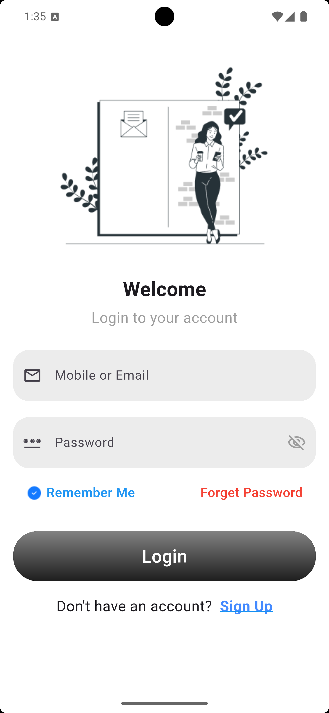
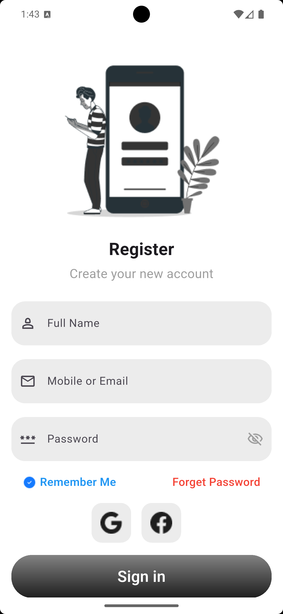
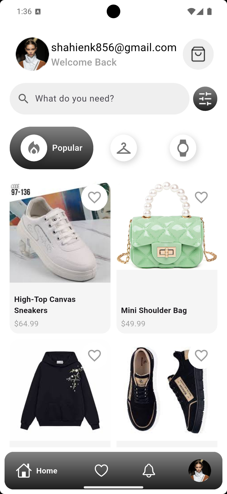
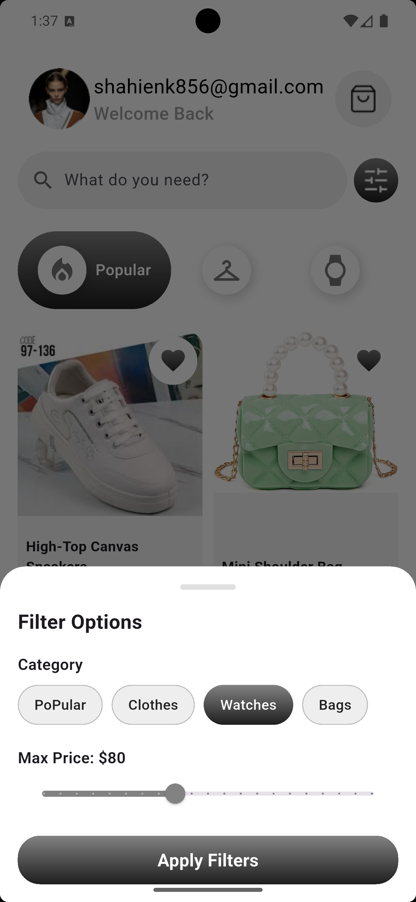
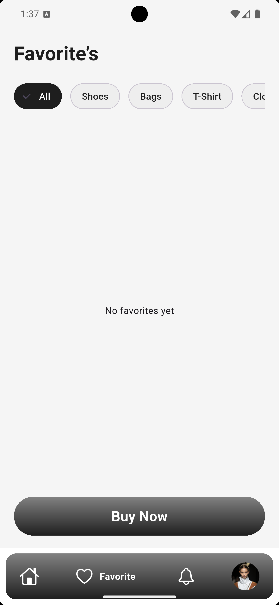

# Shopping App

Shopping App is a Flutter commerce interface with onboarding, authentication,
product discovery, filtering, favorites, order details, notifications, and
profile flows. Firebase provides account and product data for the project.

> Portfolio project. Payment, delivery, and store-release flows are UI
> demonstrations rather than production commerce services.

## Interface

<p align="center">
  
  
  
  
</p>

<p align="center">
  
  
  
</p>

## Technical overview

- Flutter and responsive size utilities
- BLoC and Cubit for authentication and product state
- Firebase Authentication and Cloud Firestore
- Google and Facebook sign-in packages
- `go_router` navigation and reusable feature widgets

The code uses a pragmatic feature-first structure with shared routing, styling,
Firebase access, and reusable widgets under `lib/core`. It does not claim
uniform Clean Architecture layers across every feature.

## Run locally

```bash
git clone https://github.com/Khaled-shahien/Shopping_App.git
cd Shopping_App
flutter pub get
flutter run
```

To use a separate Firebase project:

```bash
flutterfire configure
```

Configure OAuth providers in Firebase and their platform consoles before using
social sign-in. Firebase client API keys should be restricted to the intended
applications and APIs.

## Quality status

```bash
dart format --output=none --set-exit-if-changed lib
flutter analyze --no-pub
```

Static analysis passes. The repository does not currently contain automated
tests, so its workflow validates formatting and analysis without claiming test
coverage.

## Roadmap

- Add authentication and product Cubit tests
- Add widget tests for loading, empty, and error states
- Add Firebase emulator coverage
- Replace demonstration order and payment screens with service-backed flows

## Maintainer

Built and maintained by [Khaled Shahien](https://github.com/Khaled-shahien).
